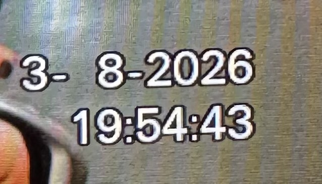
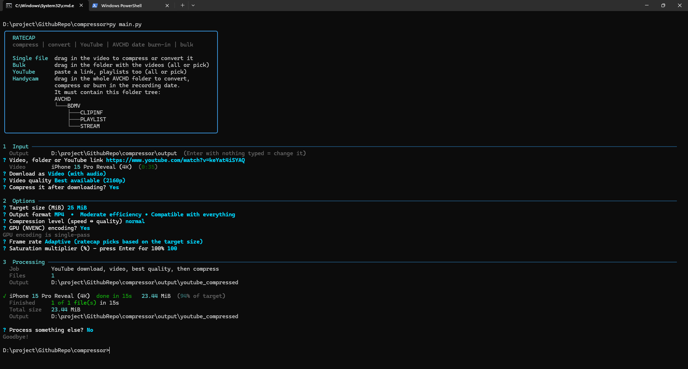
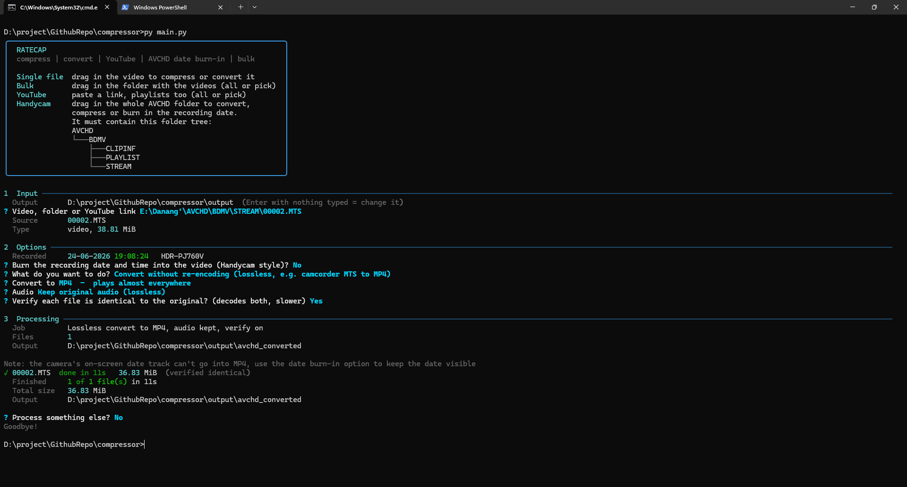
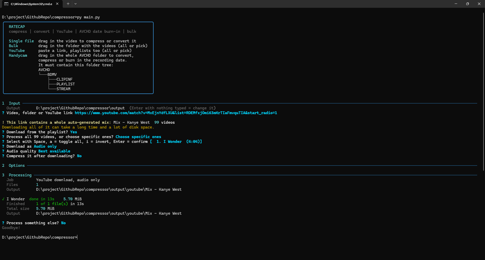
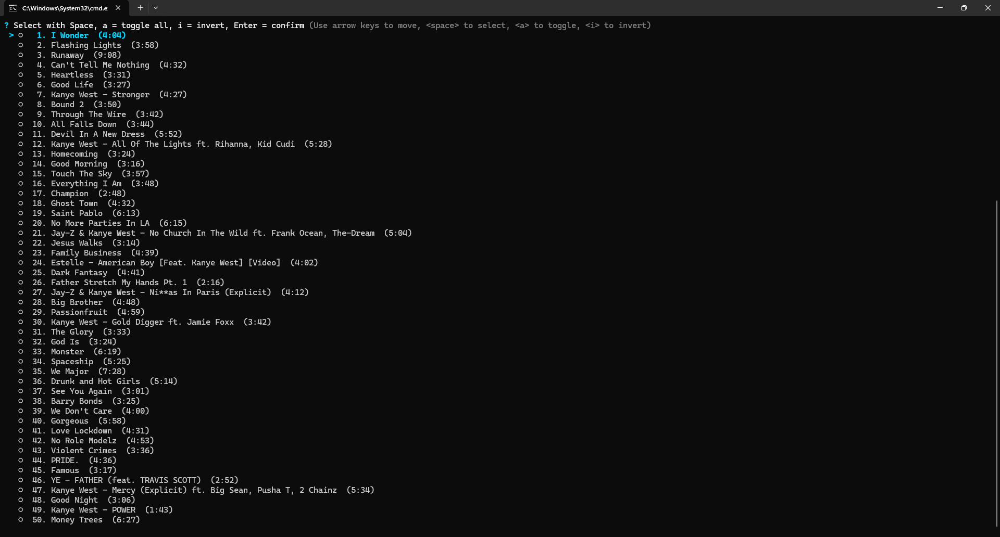
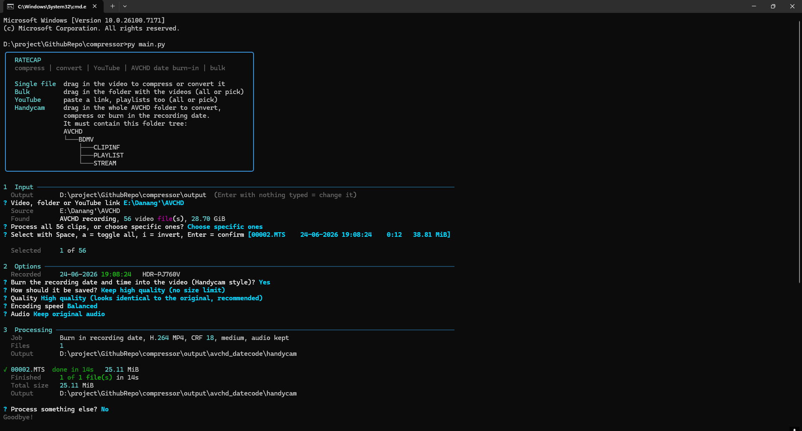
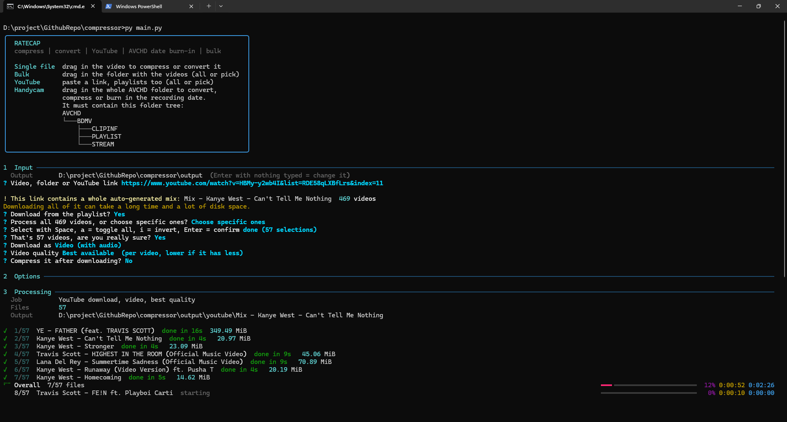

# ratecap

A simple, offline, FFmpeg-based tool with a console interface. Fit video, audio and images into a target file size, convert video without re-encoding, download from YouTube, and process Sony Handycam (AVCHD) footage in bulk, including burning the recording date and time into the picture.

## Features

* Compress video, audio and images to a target file size (quick presets or custom)
* Lossless converter: re-wrap video into MP4 or MKV with no re-encoding, with optional verification
* YouTube download: video or audio, quality choice, optional compress right after
* Playlists: download all videos or pick specific ones
* Bulk mode: drag in a folder or several files and process them all, or pick specific ones
* Sony Handycam (AVCHD) support: lossless convert, compress, and burn in the recording date and time in the camera's own style
* A compact technical summary of the file you drag in (codec, resolution, frame rate, bitrate, audio, size)
* Optional 2-pass encoding (CPU only, higher accuracy)
* Optional GPU encoding (NVENC, MP4 only, faster but less precise)
* Frame rate control: keep original, a fixed rate (60, 59.94, 50, 30, 29.97, 25, 24, 23.976) or adaptive
* Compression levels: fastest / fast / normal / maximum
* Saturation adjustment (0-200%) for video and images
* Per-file progress with the time each file took and its size before and after, plus an overall bar with ETA in bulk jobs
* Output is always at or under the target size
* Remembers: output folder, 2-pass, GPU and your last convert settings
* Never overwrites files (adds _1, _2, ... when needed) and never touches the originals
* 100% local, no internet needed except for YouTube downloads

## Requirements

* Python 3.9 or newer. **Python 3.15.2 is recommended**: it supports lazy imports, so ratecap starts noticeably faster.
* FFmpeg & ffprobe (add to PATH)

  * Download full build: [https://www.gyan.dev/ffmpeg/builds/](https://www.gyan.dev/ffmpeg/builds/)
  * or run in PowerShell:

    ```bash
    winget install -e --id Gyan.FFmpeg --exact
    ```
* A JavaScript runtime for YouTube downloads (only needed for the YouTube feature)

  * [Deno](https://deno.com) is recommended; yt-dlp uses it automatically
  * Node.js or Bun also work if already installed
* Python packages:

  ```bash
  pip install -r requirements.txt
  ```

## Installation

1. Make sure FFmpeg is in your system PATH
2. Download or clone this repository:

   ```bash
   git clone https://github.com/Limitrious/ratecap
   cd ratecap
   ```
3. Install dependencies:

   ```bash
   pip install -r requirements.txt
   ```
4. Run:

   ```bash
   python main.py
   ```

## How to use

Run it and drag something into the window at the first prompt.

| Drag in | What you can do |
| --- | --- |
| A video, audio file or image | Compress it to a target size, or convert a video without re-encoding |
| A folder of videos, or several files selected together | The same, in bulk: all files or only the ones you pick |
| A YouTube link | Download video or audio, optionally compress it. Playlists: all videos or only the ones you pick |
| The AVCHD folder from a Handycam | Lossless convert, compress, or burn in the recording date and time |

For Handycam footage, drag in the whole `AVCHD` folder. It must contain this folder tree:

```
AVCHD
└───BDMV
    ├───CLIPINF
    ├───PLAYLIST
    └───STREAM
```

The clips are read from `STREAM`. Anything else on the card (like `DCIM` photos) is ignored. You can also copy the `AVCHD` folder from the card to your PC first, any location works.

Press Enter with nothing typed at the first prompt to change the output folder.

## Output folders

Results are sorted by what was done to the file, inside one `output` folder next to the script. A folder is only created when it is used.

| Folder | What goes in it |
| --- | --- |
| `compressed` | Files compressed to a target size |
| `converted` | Files converted without re-encoding |
| `youtube` | YouTube downloads saved as they are |
| `youtube_compressed` | YouTube downloads that were compressed |
| `avchd_converted` | Handycam clips converted without re-encoding |
| `avchd_datecode` | Handycam clips with the date burned in (high quality) |
| `avchd_compressed` | Handycam clips compressed to a target size, with or without the date |

When the input is a folder or a YouTube playlist, the results go into a subfolder named after it, such as `avchd_converted/handycam/`. Changing the output folder at the first prompt changes where the `output` folder itself lives. The setting is saved in `config.json`.

## Compress

1. Drag in a video, audio file or image (or a folder of videos)
2. Choose the target size (1 / 8 / 10 / 20 / 25 / 50 / 100 / 500 MiB or custom)
3. Choose the output format
4. Choose the compression level
5. For video: GPU encoding (NVENC, MP4 only, shown when available), 2-pass encoding, frame rate, saturation

Output formats depend on the input. Video: MP4, WebM, AV1 MKV, or audio only (MP3, M4A, OGG). Audio: MP3, M4A, OGG. Images: PNG/JPEG (PNG if it fits, otherwise JPEG), WebP, AVIF. Video inputs include MTS / M2TS (AVCHD), MP4, MOV, MKV, AVI, MPG, WMV, WebM, 3GP, FLV and MXF.

## Convert without re-encoding

For footage that needs a friendlier container, such as camcorder `.MTS` files. The video is copied as is, so there is no quality loss and it finishes in seconds.

1. Choose **Convert without re-encoding** after picking a file or folder
2. Choose the container
   * **MP4**: plays almost everywhere
   * **MKV**: keeps every stream exactly as recorded
3. Choose the audio handling (MP4 only)
   * Keep the original audio (lossless)
   * Convert to AAC 256 kbps for devices that don't play AC-3
4. Choose whether to verify each file. Verification decodes the original and the result and compares them, so it takes longer but proves nothing changed.

What happens to the streams:

* Video is copied, including interlacing. Nothing is deinterlaced or re-encoded.
* AC-3, AAC, MP3 and other MP4-compatible audio is copied as is.
* LPCM audio (used by some Sony models) is stored losslessly as ALAC in MP4 or FLAC in MKV.
* A Handycam's on-screen date track (a picture subtitle) is kept when converting to MKV. MP4 cannot hold it, so you get a note; use the date burn-in below to keep the date visible in an MP4.
* If a file holds something MP4 can't carry cleanly (for example MPEG-2 video), that file is written as MKV instead and you get a note.
* The output file keeps the original's date, and `creation_time` is filled in when the original has none.

## YouTube download

Paste a YouTube link at the first prompt instead of a file path.

1. If the link contains a playlist, you get a warning with the number of videos and a confirm (default: no)
   * **No**: the playlist part is removed from the link and only that video is downloaded
   * **Yes**: choose **all videos** or **pick specific videos** from a list (a second confirm appears above 50 videos)
   * Links that are a playlist only (no single video in them) go back to the input prompt on No
2. Choose **Video** or **Audio only**
3. Choose quality
   * Video: best available or a resolution cap (1080p, 720p, ...)
   * Audio: best, up to 128 kbps, or up to 64 kbps
4. Choose whether to compress it afterwards
   * **No**: saved to the output folder (video as MP4, audio as M4A)
   * **Yes**: the usual size / format / level questions follow, only the compressed file is kept

A video that fails (private, deleted, region-locked) is skipped and the rest continue.

## Burn the recording date into the video (Handycam)

Sony Handycams show the recording date and time on the camera screen (Data Code), but most players on a PC don't. This feature draws it permanently into the picture so it shows in any player.

It recreates the camera's on-screen look: two right-aligned lines, date over time, in the lower right of the picture, medium-weight white digits with a thin black outline. Size, spacing and position were measured from a capture of a real Handycam's playback.



> I couldn't find the exact font Sony uses, so I couldn't mimic it 100% accurately. The digits are drawn with Arial, thickened slightly to match the camera's weight. It is close enough, but not identical.

Where the date comes from: the clip itself. Every `.MTS` carries Sony MDPM metadata in the video stream (a new stamp about every half second). The `.CPI` and `.MPL` files are not needed, and file dates from Windows are never assumed to be the recording date.

1. Drag in the whole `AVCHD` folder (or a single `.MTS`)
2. If there are several clips, choose all of them or pick specific ones (the list shows each clip's recording date)
3. Choose **Yes** at "Burn the recording date and time into the video?"
4. Choose how to save it
   * **Keep high quality**: H.264 MP4 at the original resolution and frame rate with all audio kept. Quality from high (default) to lossless.
   * **Compress to a target size**: the usual size, format and level options, with the date burned in

If a clip has no recording date, you are told and asked what to do: use the file's modified date (this is when the recording ended, so it may be off), type the start date and time yourself (for a single clip), or skip it. A date is never made up silently.

Notes:

* Burning text in needs a re-encode. Your original files are never changed.
* Interlaced footage is deinterlaced at the same frame rate (29.97i becomes 29.97p, 50i becomes 25p).
* The date rolls over correctly when a clip crosses midnight.
* The output file keeps the recording's file date.

## Demos

**Compress a video or a folder of videos**



**Convert without re-encoding**



**YouTube download**



**Playlist: pick specific videos**



**AVCHD: lossless convert/burn in the recording date**



**Bulk progress**



## Notes

* CPU encoding gives the most accurate file size
* GPU encoding (NVENC) is single-pass, faster but less precise
* 2-pass encoding is only effective on CPU encoders
* Adaptive frame rate halves the frame rate (60 to 30, 59.94 to 29.97, 50 to 25) only when that lets the video keep noticeably more resolution, and never goes below 24 fps
* A fixed frame rate above the source rate is ignored, frames are never duplicated to fake a higher rate
* Very short or already small files may not match the exact target size
* Targets too small for the video's length are rejected, and if the size can't be reached you get a warning
* Audio-only files ignore saturation
* YouTube changes often. If downloads fail, update yt-dlp: `pip install -U "yt-dlp[default]"`
* Live streams are not supported
* Only YouTube links are recognized (youtube.com, music.youtube.com, youtu.be)

## Contributing, bug reports and suggestions

Feel free to make improvements. I left some notes inside the source code (`main.py`), so have a look there first.

Bug reports and suggestions are welcome at [github.com/Limitrious/ratecap/issues](https://github.com/Limitrious/ratecap/issues).

**Have a different Handycam or camcorder model?** If you want the same date burn-in with the same style of timestamp as your own camera's video playback, open an issue and post a clear picture of how it should look, preferably with the font (its name or a sample of it). The layout lives in the `DC_*` constants at the top of the date burn-in section of `main.py`.

And if you know a simple, lightweight, command-line-style way to make the interface better, I'd love to hear it.

## Special thanks

Thanks to [Hlebka](https://github.com/Hlebka), who reviewed the early code, found real bugs and fixed them in [pull request #1](https://github.com/Limitrious/ratecap/pull/1). Several of the changes in ratecap came straight from that review.

## Why I made this

I originally built this only to compress video. I was fed up with video compression programs: they need too many clicks and have too many options I barely care about. All I need is my CS2 highlights at 25 MB so I can send them to my friends' Facebook Messenger group chat, but everything felt overcomplicated, and some tools don't even have a saturation option. (I use [VibranceGUI](https://vibrancegui.com/) to get that high saturation look without joining third-party lobbies full of cheaters, so saturation matters to me.) Eventually I found a website that did what I wanted, [autocompressor.net](https://autocompressor.net/), but it was slow and had some pay-to-use options. So, out of boredom and to make my everyday life a bit easier, I made this program.

Then I wanted to convert things like WebP to PNG, which seemed simple enough, so I added it.

Then came the YouTube downloader. Websites like [cobalt.tools](https://cobalt.tools/) exist, but they dropped YouTube support, so I had to find another solution. I found [Stacher](https://stacher.io/) and it was pretty good, but I'm too lazy to keep up with updating it and waiting 10 to 15 seconds every time it updates, so I added YouTube downloading to this program too.

Right when I finished the YouTube part and was about to publish on GitHub, I was honestly surprised by [Hlebka's pull request](https://github.com/Limitrious/ratecap/pull/1). I never imagined someone would care about my little repo. I only post stuff on GitHub so my free-time programs don't get wiped every time I reset Windows. He pointed out some silly bugs and fixed them, and I really appreciate it. Thank you, [Hlebka](https://github.com/Hlebka)! After seeing his fix I implemented most of it in my code, and I renamed the repo from "compressor" to "ratecap".

Then I looked at my old Sony Handycam HDR-PJ760V lying on my table, turned it on and watched the videos I recorded on it. I tried to import them to my computer and the files were `.MTS`. A quick search told me that's an old Sony AVCHD recording format. I tried to convert them to MP4, searched for websites and tools, and nothing satisfied me: they were either super slow with file size limits, or super complicated. So again, I decided to build AVCHD conversion into this program.

After that, while checking the AVCHD videos on my Handycam and on my PC to see if the files turned out okay, I noticed the little timestamp (date code, whatever it's called) on the camera that is missing on the PC. I wanted that detail on my converted videos, so I searched Reddit and Google and asked people on Discord, but I couldn't find a program that does it. There's similar stuff, but only for old VHS camcorders. So again, I added that function to this program.

With all those features added, the old UI looked so messy it honestly angered me, so I changed it. I'm still not satisfied with some aspects of the new UI and I don't know how to fix them. I really like the command-line style because it's simple and doesn't feel heavy compared to graphical interfaces, or maybe I just haven't found a framework I like: most of them look too old, outdated, rigid, boring or generic. So I'd be really grateful if you can help me build or find something simple, technical, lightweight and compact that doesn't need too many clicks. But I guess I'm too picky, or I simply have bad taste.

## License

MIT, feel free to modify and use

Made in Hanoi, 2026